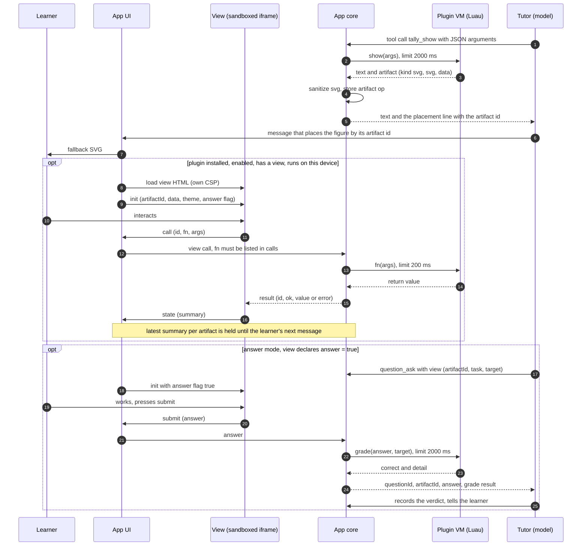

# Plugin API documentation

These files document how to write a plugin for P's Learning Harness in this registry: what a package contains, the host modules a plugin can call, how figures and interactive views work, and how a plugin is tested and published. They describe host API version 1 as the app implements it (checked against the app's source and by running its `plugin` checker on 2026-11-15). The type stubs in [`../plugin-api/`](../plugin-api/) carry the same information per function for the editor. Where a statement could not be checked by running code, the file says so.

## What a plugin is

A plugin is a folder of Luau source, JSON and optional HTML under `plugins/<id>/`. The app runs it in a sandboxed Luau VM with no access to files, the network, the clock or other programs. A plugin can add any of:

| Part | What it is | Declared in `plugin.toml` as |
|---|---|---|
| Tools | Functions the tutor (or the practice coach) calls with JSON arguments. A tool returns text, or text plus a figure | `[[tool]]`, at most 3 |
| A renderer | A function that draws the figure from stored data | `[[renderer]]`, at most 1 |
| A view | One HTML document shown in a sandboxed frame, with which the learner manipulates a figure and can submit an answer | `[[view]]`, at most 1 |
| Prompt fragments | Up to 250 words per agent, added to the agent's prompt while the plugin is in use | `[prompts]` |

A figure is an *artifact*: a static SVG plus a JSON `data` object. The SVG is stored in the session and is always available; the view is an optional interactive layer over the same data.

## Lifecycle



Points the diagram implies:

- The plugin is entered only at steps 2, 13 and 22. It never initiates anything.
- The model never sees the SVG or `data`; it sees the tool's `text`. The learner never sees `text` or `target`.
- The plugin does not decide whether an answer counts. `grade` reports; the tutor records the verdict.
- A replay of a session never runs the plugin again. It shows the stored SVG.

## The files

| File | Covers |
|---|---|
| [package.md](package.md) | Package layout, every `plugin.toml` key and its validation error, input schemas, the entry module, `require`, the sandbox and standard library, JSON ⇄ Lua conversion, tool return shapes and their errors, limits |
| [host-api.md](host-api.md) | Reference for `@harness/json`, `svg`, `num`, `rand`, `log`, `test`: signature, behaviour, errors and observed examples per function, and the gotchas of each module |
| [artifacts-and-views.md](artifacts-and-views.md) | The artifact contract and what is stored, the SVG sanitizer, the renderer, theming, the view (loading, CSP, asset inlining, message protocol), `state` summaries, answer mode and `grade`, keeping answers hidden |
| [testing.md](testing.md) | `plugin validate` and `plugin test`, type checking, golden files, writing tests, trying a plugin in the app, this registry's check and the version rule |
| [`../plugin-api/*.luau`](../plugin-api/) | Type stubs of the host modules, with the per-function documentation for the editor |

## Quick start

This builds a working plugin, `tally`, that draws horizontal bars. It needs a checkout of the app repository for the `plugin` checker ([testing.md](testing.md#the-plugin-command)) and this repository's `nix develop` shell for `luau-analyze` and the registry script. The files and outputs below were produced exactly this way.

**1. Create the folder.** The folder name is the plugin id.

```sh
mkdir -p plugins/tally/src plugins/tally/schemas plugins/tally/prompts plugins/tally/tests
```

**2. `plugins/tally/plugin.toml`**

```toml
id = "tally"
version = "0.1.0"
api = 1
title = "Tally bars"
description = "Draws labelled horizontal bars for a short list of counts."
license = "MIT"
platforms = ["desktop", "mobile"]
permissions = []
use_when = "The learner must compare a handful of counts at a glance."
avoid_when = "Two numbers would do, or exact values matter more than their sizes."
cost = "instant"

[[tool]]
name = "tally_show"
description = "Draw one horizontal bar per labelled count. Returns the total. Place the figure with ."
agents = ["tutor"]
input = "schemas/tally_show.json"
entry = "show"
artifact = true

[[renderer]]
entry = "render"

[prompts]
tutor = "prompts/tutor.md"
```

**3. `plugins/tally/schemas/tally_show.json`**, the tool's input as the model sees it:

```json
{
  "type": "object",
  "properties": {
    "items": {
      "type": "array",
      "minItems": 1,
      "maxItems": 8,
      "items": {
        "type": "object",
        "properties": {
          "label": { "type": "string" },
          "count": { "type": "number", "minimum": 0 }
        },
        "required": ["label", "count"]
      }
    }
  },
  "required": ["items"]
}
```

**4. `plugins/tally/prompts/tutor.md`**

```markdown
## Tally bars

Call `tally_show` when the point is a comparison of a few counts. Label every
bar. Place the figure once, next to the sentence that uses it.
```

**5. `plugins/tally/src/main.luau`**

```lua
--!strict
local svg = require("@harness/svg")

type Item = { label: string, count: number }
type Data = { items: { Item }, total: number }

local ROW = 24
local LEFT = 100
local WIDTH = 320

-- The model's arguments are not checked against the schema: check them here.
local function clean(args: any): Data
  assert(type(args) == "table" and type(args.items) == "table", "items must be a list")
  local items, total = {}, 0
  for i, item: any in ipairs(args.items) do
    assert(type(item) == "table" and type(item.label) == "string", `items[{i}].label must be a string`)
    assert(type(item.count) == "number" and item.count >= 0, `items[{i}].count must be a number, 0 or more`)
    items[i] = { label = item.label, count = item.count }
    total += item.count
  end
  assert(#items >= 1 and #items <= 8, "give 1 to 8 items")
  return { items = items, total = total }
end

local function draw(data: Data): string
  local max = 1
  for _, item in ipairs(data.items) do
    max = math.max(max, item.count)
  end
  local parts = {}
  for i, item in ipairs(data.items) do
    local y = (i - 1) * ROW
    local w = math.round((WIDTH - LEFT) * item.count / max)
    local label = { fill = "currentColor", stroke = "none", ["text-anchor"] = "end", ["font-size"] = 13 }
    table.insert(parts, svg.text(LEFT - 8, y + 16, item.label, label))
    table.insert(parts, svg.rect(LEFT, y + 4, w, ROW - 8, { fill = "currentColor", ["fill-opacity"] = 0.25 }))
  end
  return svg.document(WIDTH, #data.items * ROW, table.concat(parts))
end

local function show(args: any)
  local data = clean(args)
  return {
    text = `{#data.items} bars; the total is {data.total}.`,
    artifact = { kind = "svg", svg = draw(data), data = data },
  }
end

return {
  show = show,
  render = draw,
}
```

**6. `plugins/tally/tests/tally.luau`**

```lua
local main = require("../src/main")
local golden = require("@harness/test").golden

local args = { items = { { label = "Cats", count = 3 }, { label = "Dogs", count = 6 } } }

return {
  totals = function()
    local out = main.show(args)
    assert(out.text == "2 bars; the total is 9.", out.text)
    assert(out.artifact.kind == "svg")
    assert(out.artifact.data.total == 9)
  end,
  figure = function()
    golden("two-bars.svg", main.show(args).artifact.svg)
  end,
  renderer_redraws_the_stored_data = function()
    local out = main.show(args)
    assert(main.render(out.artifact.data) == out.artifact.svg)
  end,
  bad_input_is_an_error = function()
    local ok, err = pcall(main.show, { items = { { label = "Cats" } } })
    assert(not ok and string.find(tostring(err), "items[1].count must be a number", 1, true), tostring(err))
  end,
}
```

**7. Validate, write the golden file, test.**

```console
$ plugin validate plugins/tally
ok: tally 0.1.0
$ PLUGIN_UPDATE_GOLDEN=1 plugin test plugins/tally
$ plugin test plugins/tally
manifest ok: tally 0.1.0 (1 tools)
luau-analyze: ok
4 test(s) passed:
  plugins/tally/tests/tally.luau::bad_input_is_an_error
  plugins/tally/tests/tally.luau::figure
  plugins/tally/tests/tally.luau::renderer_redraws_the_stored_data
  plugins/tally/tests/tally.luau::totals
```

The golden file `plugins/tally/tests/golden/two-bars.svg` now holds the figure (one line):

```text
<svg xmlns="http://www.w3.org/2000/svg" width="320" height="48" viewBox="0 0 320 48" fill="none" stroke="currentColor"><text fill="currentColor" font-size="13" stroke="none" text-anchor="end" x="92" y="16">Cats</text><rect fill="currentColor" fill-opacity="0.25" x="100" y="4" width="110" height="16"/><text fill="currentColor" font-size="13" stroke="none" text-anchor="end" x="92" y="40">Dogs</text><rect fill="currentColor" fill-opacity="0.25" x="100" y="28" width="220" height="16"/></svg>
```

Open it in a browser to look at it.

**8. Run the registry check.** `scripts/registry.sh check` packs every plugin under `plugins/` into `out/packages/`, checks the manifest fields the index carries, the file sizes and the version rule against the published index, and writes the index a publish would deploy to `out/site/index.json`. It writes nothing remote. It does not run `plugin test`.

```console
$ scripts/registry.sh check
  tally                    0.1.0        new        ee0e25959ef0041e124dc44a9094b149f985ff741f1db53ecc067e383af40d45

Wrote out/site/index.json: 1 plugin(s), 1 new version(s).
```

(The run shown used a copy of this repository that held only `tally`, with `REGISTRY_BASE=none`; in the real repository every plugin is listed, and the sha256 depends on the pinned `tar` and `gzip`.)

**9. Try it in the app, then open a pull request.** See [testing.md](testing.md#trying-a-plugin-in-the-app). After a version is published, any change to the folder needs a higher `version`.

From here: add a view and answer mode with [artifacts-and-views.md](artifacts-and-views.md); look up a host function in [host-api.md](host-api.md).

## What a plugin cannot do

Enforced by the host in api 1:

- **No I/O.** No files, network, processes, environment variables. `io`, `os`, `debug`, `package`, `load`, `loadstring`, `dofile`, `loadfile`, `collectgarbage` do not exist.
- **No clock and no ambient randomness.** There is no time source. `math.random` exists but is not reproducible; the supported generator is seeded by the caller.
- **No permissions.** `permissions` must be empty; a Luau plugin cannot request access.
- **No code outside the package.** `require` loads only `.luau` files under `src/` and the six host modules. No bare names, no aliases, no code from strings.
- **No persistent state.** Nothing survives the VM, and the VM is discarded on any error and whenever the app restarts. The only durable output is an artifact's SVG and `data`.
- **No initiative.** A plugin runs only when a tool is called, a view calls a listed function, or an answer is graded. It cannot message the learner or the model, schedule work, or call other tools or plugins.
- **No more than 3 tools, 1 renderer, 1 view**, and prompt fragments of at most 250 words for `tutor` and `practice` only.
- **No long or large computations.** 2 s per tool call and per `grade`, 200 ms per view call, 64 MiB of memory, 16 KiB of result text, 256 KiB of artifact data, 256 KiB of SVG, matrices up to 400×400.
- **No artifact kind other than `"svg"`**, and no scripts, styles, animation, embedded HTML or external references in it: the sanitizer removes them.
- **No network or storage in a view.** The view's frame can run inline script and style and talk to the app by `postMessage`; it cannot fetch, navigate, open windows, store data, or reach the app's page. It can call only the functions listed in `calls`.
- **No access to the grading target from the view, and no verdict from the plugin.** `target` reaches only `grade`; the result reaches only the tutor.
- **No reading the session.** A plugin sees the arguments of the call it is handling and nothing else: not the conversation, not the learner's identity, not other artifacts, not its own artifact's id at tool time.
- **No trusting the input.** Tool arguments are not validated against the schema, view submissions are arbitrary JSON, and `target` is written by a model.
